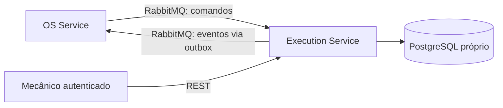

# Oficina Execution Service

Microsserviço responsável pelo catálogo e estoque de peças, reservas por ordem de serviço e fila de
execução de diagnóstico/reparo. Não mantém o status oficial da OS nem acessa o banco do OS Service.

## Arquitetura

O serviço mantém inventário com controle otimista (`@Version`), reserva/liberação/consumo idempotentes
por `osId` e tarefas priorizadas. A conclusão do diagnóstico grava o snapshot dos itens e reserva as
peças na mesma transação. Um cancelamento de reparo não finalizado devolve ao estoque as peças
consumidas; se o reparo já terminou, o serviço reafirma `ExecucaoFinalizada`. As respostas assíncronas
saem por outbox; comandos duplicados são filtrados por inbox.

## Desenvolvimento

- Java 21; Docker/Compose de plataforma da pasta `oficina-infra-k8s/local`.
- `./mvnw spring-boot:run -Dspring-boot.run.profiles=local` desliga autenticação explicitamente.
- Defina `SPRING_DATASOURCE_URL=jdbc:postgresql://localhost:5433/execution_db`,
  `SPRING_DATASOURCE_USERNAME=oficina`, `SPRING_DATASOURCE_PASSWORD=oficina` e
  `SPRING_RABBITMQ_HOST=localhost`. Fora do perfil `local`, `JWT_SECRET` é obrigatório
  (segredo compartilhado HS256); o perfil `local` usa uma chave exclusiva de desenvolvimento.
- Swagger: `/swagger-ui.html`; health: `/actuator/health`.
- O perfil local usa o gateway RabbitMQ da plataforma e deve ter a topologia versionada em
  `oficina-infra-k8s/local/rabbitmq/definitions.json`.

## Endpoints principais

- `GET/POST/PUT/DELETE /pecas`, `POST /pecas/{id}/repor-estoque`,
  `GET /pecas/alertas/estoque-baixo` e `/estoque-critico`.
- `GET /tarefas?status=NA_FILA` lista tarefas por prioridade e chegada.
- `POST /tarefas/{id}/iniciar-diagnostico`, `/diagnostico/concluir`,
  `/iniciar-reparo`, `/progresso` e `/finalizar`.

## Mensageria

- Consome `SolicitarDiagnostico`, `IniciarExecucao`, `CancelarExecucao` e `LiberarReservaPecas` da fila
  `execution.comandos`.
- Publica `DiagnosticoIniciado`, `DiagnosticoConcluido`, `ExecucaoIniciada`, `ExecucaoRecusada`,
  `ExecucaoCancelada`, `ExecucaoFinalizada` e `ReservaPecasLiberada` pelo outbox.
- Payloads e exemplos versionados: [contratos_mensagens.md](../oficina/documentacao/contratos_mensagens.md).
- O OS Service coordena o fluxo pela Saga e mantém o status oficial da ordem de serviço.

## Kubernetes

Manifests Kustomize em `k8s/`: Deployment, Service, ConfigMap, Secret local de desenvolvimento,
HPA, ServiceMonitor e PostgreSQL próprio com PVC. Em ambientes compartilhados, substitua o Secret
local por segredo gerenciado fora do repositório.

## Qualidade e demonstração

- CI (`ci.yml`): `./mvnw verify` (unitários, contexto com H2, `@DataJpaTest`, contrato, ArchUnit, Spotless,
  JaCoCo ≥ 80%), SonarCloud com Quality Gate e testes de integração (`./mvnw verify -Pintegracao`) num job separado.
- CD (`cd.yml`): imagem no GHCR, deploy dos 3 serviços num cluster kind e smoke test E2E da Saga.
- Branch `main` protegida: merge só por pull request com o CI verde.
- Fluxo de demonstração e collection Postman: [documentação da Fase 4 no OS Service](https://github.com/gabrielivo01/Oficina#demonstração-e-qualidade).
